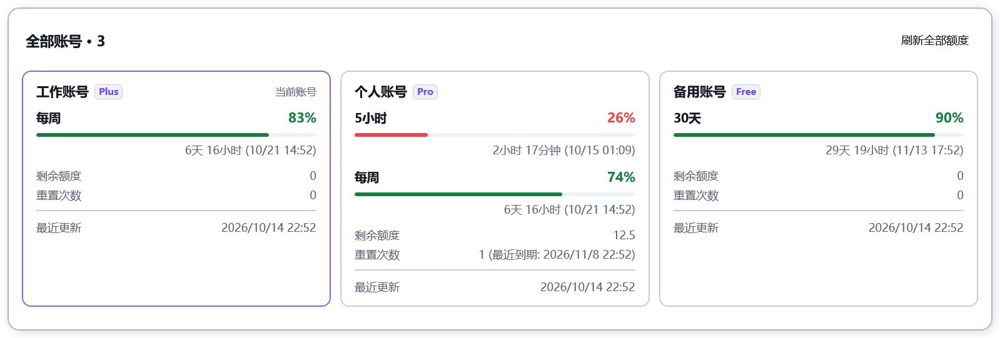

# Codex 账号管理器

**账号独立多开 · 窗口直接跳转 · 套餐与额度总览**

一条可拖动的账号栏，管理多个 Codex 桌面窗口。

**[下载 EXE](https://github.com/babatuosi936/codex-swap-account-zh-cn/releases/latest/download/CodexProfileOverlay.exe)** · [下载便携包](https://github.com/babatuosi936/codex-swap-account-zh-cn/releases/latest/download/CodexProfileOverlay-win-x64-portable.zip) · [v1.3.1 更新说明](https://github.com/babatuosi936/codex-swap-account-zh-cn/releases/tag/v1.3.1-update.20261014) · [English](README_EN.md)

Windows 10/11 x64 · 独立桌面工具 · 无需安装 .NET

## 多个账号，各自一个窗口

把常用账号添加到账号栏后，点击即可使用：

| 账号状态 | 点击后的行为 |
| --- | --- |
| 窗口已经打开 | 直接跳转到该账号窗口；原始窗口和独立窗口都支持。 |
| 窗口尚未打开 | 选择“打开新的独立窗口”或“切换当前账户”，默认选中新窗口。 |
| 窗口已最小化 | 还原并跳转到该窗口。 |
| 关闭该账号最后一个窗口 | 先等待正常退出，再清理已核验属于该账号的残留桌面后台；其他账号继续运行。 |

独立窗口保留各自的登录资料和桌面缓存，共用已有本机 Codex 历史。其他账号窗口可以继续运行，**无需 Cockpit Tools**。

## 账号、套餐、额度，一眼看清

账号栏显示当前账号、服务端返回的 **Plus / Pro / Free** 等套餐，以及实际可查询到的剩余额度。

套餐标记默认显示。在 **设置 → 外观 → 显示账号套餐** 中可以隐藏；账号栏、紧凑列表和总览同步更新，额度仍然显示。

点击或悬停“总览”可查看所有账号，每行最多三个，更多账号自动换行。详情显示剩余百分比、重置倒计时、更新时间，以及可查询到的积分余额和重置机会。

- 支持实际返回的额度周期，例如 **5 小时、每周、30 天**；不为账号补造不存在的额度。
- 可刷新单个账号，也可在总览中刷新全部账号。
- 默认当前账号每 30 秒、其他账号每 60 秒查询一次，可在设置中调整。查询不到时显示不可用，旧数据会标注。

## 按自己的习惯摆放

| 操作 | 效果 |
| --- | --- |
| 长按账号后拖动 | 调整账号顺序。 |
| 拖动账号栏其他区域 | 移动整个浮层。 |
| 菜单 → 最小化 | 缩成可拖动的小球；点击还原，回到最小化前的位置。 |
| 设置 → 外观 | 调整展开/紧凑布局、位置、缩放和明暗主题。 |
| 设置 → 快捷键 | 配置或清除快捷键；点击“保存”后生效。 |

 &nbsp; 

紧凑布局适合较窄的窗口；自动布局会根据可用宽度切换。位置重置使用“菜单右侧”，新配置默认开启 Windows 自启动；已有设置可以在设置页调整。

顶部账号栏从 Codex 客户区横向 **340** 的位置起摆放，避开左侧菜单和右侧最小化、最大化、关闭按钮。空间不足时缩短账号栏，**总览和末尾菜单固定在两端**，鼠标滚轮左右浏览中间账号，不显示滚动条。账号减少时也会收紧长度。

拖到标题栏下方后展开全部账号；拖回顶部重新适配可用空间。同一区域内拖动保持长度，只有跨区域或窗口、内容、缩放变化时重新适配。全部账号比窗口本身还宽时保留滚动。

## 开始使用

1. 下载上方 **EXE**，放到固定文件夹后双击运行。想保留说明文档，也可以下载 ZIP，解压后运行同一个 EXE。
2. 打开 Codex 桌面版，账号栏会在识别到窗口后显示。浮层的紫色托盘图标可进入账号和设置。
3. 在账号栏菜单中选择“添加账号”，完成登录并设置显示名称。
4. 点击目标账号。未打开时保留默认的“打开新的独立窗口”，之后点击账号即可在窗口间跳转。

添加账号与自动额度查询需要可用的 **Codex CLI**。独立多开已在 **Windows 商店版 Codex 26.1007.2314.0** 核验，其他安装方式与版本的验证范围见[多开说明](docs/ISOLATED_MULTI_ACCOUNT.md)。

配图来自当前版本的真实控件，账号名称、套餐和额度均为演示数据。

## 使用前了解这两点

**共享的是本机 Codex 历史。** 各账号的登录资料分开；这不等同于合并不同 ChatGPT 账号的云端聊天，也不保证其他窗口即时刷新。同一个对话请在一个窗口中继续。

**“切换当前账户”会关闭当前 Codex 后切换登录。** 想保留正在使用的窗口，请选择“打开新的独立窗口”。遇到非空独立历史、错误目录链接或不兼容的旧实例时，工具会停止并保留原数据，具体处理见[多开说明](docs/ISOLATED_MULTI_ACCOUNT.md)。

## 文档与反馈

[高级设置](docs/ADVANCED_SETTINGS.md) · [多开实现与验证范围](docs/ISOLATED_MULTI_ACCOUNT.md) · [开发与构建](docs/DEVELOPMENT.md) · [升级记录](CHANGELOG_ZH.md) · [隐私说明](docs/PRIVACY.md) · [提交问题](https://github.com/babatuosi936/codex-swap-account-zh-cn/issues)

反馈时请提供版本、显示缩放与复现步骤，并遮挡截图里的邮箱和账号信息。

## 来源与许可证

基于 [ZOONGG/codex-swap-account](https://github.com/ZOONGG/codex-swap-account) 二次开发，保留 [MIT 许可证与版权声明](LICENSE)。本项目维护中文界面、独立多开、额度展示和浮层交互；新增多开实现不依赖 Cockpit Tools。感谢原作者与贡献者。

独立维护的社区工具，与 OpenAI 无隶属关系。上游说明保留在 [README_UPSTREAM.md](README_UPSTREAM.md)。
