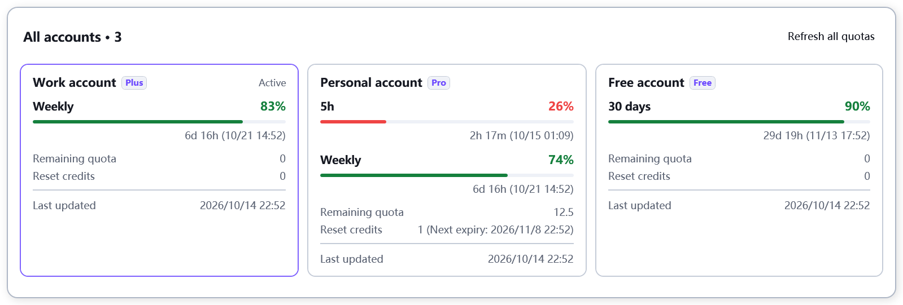
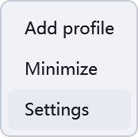

# Codex Account Manager

**Separate account windows · Direct window switching · Plans and quotas**

One draggable account bar for multiple Codex desktop windows.

**[Download EXE](https://github.com/babatuosi936/codex-swap-account-zh-cn/releases/latest/download/CodexProfileOverlay.exe)** · [Portable ZIP](https://github.com/babatuosi936/codex-swap-account-zh-cn/releases/latest/download/CodexProfileOverlay-win-x64-portable.zip) · [v1.3.1 release](https://github.com/babatuosi936/codex-swap-account-zh-cn/releases/tag/v1.3.1-update.20261014) · [简体中文](README.md)

Windows 10/11 x64 · Standalone desktop tool · No separate .NET installation

## A separate window for each account

Add your accounts to the bar, then select the account you want to use:

| Account state | What happens when selected |
| --- | --- |
| Window already open | Focus that account's window directly, including the original desktop window. |
| Window not open | Choose **Open a new independent window** or **Switch current account**. The new window is selected by default. |
| Window minimized | Restore and focus the window. |
| Last window of the account closed | Allow normal exit, then stop verified residual desktop workers for that account; other accounts remain running. |

Each independent window keeps its own sign-in and desktop cache while using the existing local Codex history. Other account windows can stay open. **Cockpit Tools is not required.**

## Accounts, plans and remaining quotas

The bar highlights the current account and shows reported **Plus / Pro / Free** plans and available remaining quotas.

Plan badges are visible by default. Disable **Settings → Appearance → Show account plan** to hide them across the bar, compact list and overview while retaining quota information.

Click or hover over **Overview** to inspect all accounts. Cards wrap after three columns. Details show remaining percentages, reset countdowns, last update times, and returned credit balances or reset opportunities.

- Display actual returned quota periods, such as **five hours, weekly and 30 days**, without inventing unavailable limits.
- Refresh one account from its detail card or all accounts from the overview.
- By default, query the current account every 30 seconds and other accounts every 60 seconds. Adjust these intervals in settings. Unavailable and cached data are labeled.

## Arrange it your way

| Action | Result |
| --- | --- |
| Hold and drag an account | Reorder accounts. |
| Drag other parts of the bar | Move the entire overlay. |
| Menu → Minimize | Turn the bar into a draggable ball; clicking it restores the previous full-size position. |
| Settings → Appearance | Adjust expanded/compact layouts, position, scale and theme. |
| Settings → Hotkeys | Set or clear optional shortcuts, then click **Save**. |

 &nbsp; 

Compact layout fits narrower windows; automatic layout adapts to available width. Position reset uses **After menu**. New settings enable Windows startup by default; existing preferences can be changed in settings.

The top bar starts at horizontal **340** relative to the Codex client, protecting the left menus and right minimize, maximize and close controls. When space is limited, shorten the bar and keep **Overview and the final menu fixed at its ends**. Use the mouse wheel to browse accounts in the middle without a visible scrollbar. Removing accounts also shrinks the bar.

Dragging below the title row expands the full account row; returning to the top fits the available space again. Movement within either region keeps the same width. Region changes, window resizing, content changes and scaling can resize it. Scrolling remains available if the full row exceeds the window itself.

## Get started

1. Download the **EXE**, place it in a permanent folder and run it. Alternatively, extract the ZIP to keep the documentation with the same executable.
2. Open Codex desktop. The bar appears after detecting its window. The purple overlay tray icon also provides account and settings access.
3. Select **Add profile** from the bar's menu, complete sign-in and choose a display name.
4. Select an account. Keep the default separate-window action for accounts not yet open, then use the bar to move between their windows.

Adding accounts and querying quotas require a working **Codex CLI**. Separate account windows have been checked on **Windows Store Codex 26.1007.2314.0**. See the [multi-account guide](docs/ISOLATED_MULTI_ACCOUNT.md) for other installation types and validation limits.

Screenshots use current application controls with synthetic account names, plans and quotas.

## Two things to know

**Shared history is local Codex history.** Sign-ins remain separate. This does not merge different ChatGPT accounts' cloud chats or guarantee immediate refresh in other windows. Continue each conversation in one window.

**Switch current account closes the current Codex before changing its sign-in.** Choose a separate window to keep existing windows running. Independent private histories, incorrect directory links and incompatible old instances are preserved and rejected; see the [multi-account guide](docs/ISOLATED_MULTI_ACCOUNT.md).

## Documentation and feedback

[Advanced settings](docs/ADVANCED_SETTINGS.md) · [Multi-account implementation and validation](docs/ISOLATED_MULTI_ACCOUNT.md) · [Development and builds](docs/DEVELOPMENT.md) · [Changelog](CHANGELOG.md) · [Privacy](docs/PRIVACY.md) · [Report an issue](https://github.com/babatuosi936/codex-swap-account-zh-cn/issues)

Include the app version, display scaling and reproduction steps. Hide email addresses and account details in screenshots.

## Origin and license

Based on [ZOONGG/codex-swap-account](https://github.com/ZOONGG/codex-swap-account), with its [MIT license and copyright notices](LICENSE) retained. This fork maintains Chinese support, separate account windows, quota display and overlay interactions. The new multi-window implementation does not depend on Cockpit Tools. Thanks to the original author and contributors.

An independently maintained community tool, unaffiliated with OpenAI. Original documentation is retained in [README_UPSTREAM.md](README_UPSTREAM.md).
